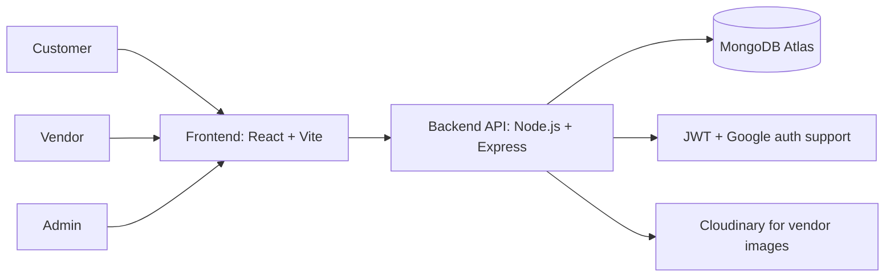

# Slotify


Slotify is a multi-vendor booking marketplace for customers, vendors, and admins. It helps people discover trusted service providers, compare offerings, and book appointments, while giving vendors a clean dashboard to manage services, availability, and bookings.

The project is built with a practical SaaS layout in mind: a React frontend, an Express + MongoDB backend, role-based access, and deployment-ready environment checks.

## Table of Contents

- [Overview](#overview)
- [What Slotify Does](#what-slotify-does)
- [Architecture](#architecture)
- [Tech Stack](#tech-stack)
- [Project Structure](#project-structure)
- [Getting Started](#getting-started)
- [Environment Variables](#environment-variables)
- [Seed Data](#seed-data)
- [Deployment](#deployment)
- [Security Notes](#security-notes)
- [Roadmap](#roadmap)

## Overview

Slotify focuses on appointment scheduling in Ethiopia. The product is designed so customers can find service providers quickly, vendors can manage their business digitally, and administrators can keep the platform organized and safe.

## What Slotify Does

| Audience | Capabilities |
| --- | --- |
| Customers | Browse vendors, search and filter services, book appointments, and review booking history |
| Vendors | Create and manage services, control availability, review incoming bookings, and track basic performance |
| Admins | Manage vendors and users, monitor bookings, and oversee platform activity |

### Core Product Areas

- Authentication and authorization with JWT and role-based access control
- Vendor discovery, profiles, and service listings
- Booking flow with time-slot generation and conflict prevention
- Vendor dashboard for service and availability management
- Admin dashboard for platform-level operations

## Architecture



## Tech Stack

| Layer | Tools |
| --- | --- |
| Frontend | React, TypeScript, Vite, Tailwind CSS, React Router, React Query |
| Backend | Node.js, Express, Mongoose, JWT, bcryptjs, Helmet, CORS |
| Media | Cloudinary |
| Validation | Zod and custom validators |
| Deployment | Vercel, Render or Railway, MongoDB Atlas |

## Project Structure

```text
Slotify/
├── frontend/   React + Vite client application
├── backend/    Express API and database logic
├── DEPLOYMENT.md
└── README.md
```

## Getting Started

### Prerequisites

- Node.js 20 or newer
- npm 10 or newer
- MongoDB connection string for local or hosted development

### Install and run locally

```bash
cd backend
npm install
npm run dev
```

```bash
cd frontend
npm install
npm run dev
```

If you want realistic local data, seed the backend first:

```bash
cd backend
npm run seed:local
```

### Useful scripts

| Location | Script | Purpose |
| --- | --- | --- |
| backend | `npm run dev` | Start the API in watch mode |
| backend | `npm test` | Run backend tests |
| backend | `npm run verify:deploy-env` | Validate backend deployment variables |
| backend | `npm run seed:local` | Load local fixture data |
| frontend | `npm run dev` | Start the Vite dev server |
| frontend | `npm run lint` | Run ESLint |
| frontend | `npm run build` | Type-check and build the app |
| frontend | `npm run verify:deploy-env` | Validate frontend deployment variables |

## Environment Variables

Use the example environment files in the repository as the starting point for local, staging, and production setups.

### Backend

Required:

```bash
NODE_ENV=production
PORT=5000
MONGO_URI=...
JWT_ACCESS_SECRET=...
JWT_ACCESS_EXPIRES_IN=7d
GOOGLE_CLIENT_ID=...
CORS_ORIGINS=https://your-frontend-domain
RATE_LIMIT_WINDOW_MS=900000
RATE_LIMIT_MAX_REQUESTS=300
RATE_LIMIT_AUTH_MAX_REQUESTS=30
```

Optional, recommended for hosted vendor images:

```bash
CLOUDINARY_CLOUD_NAME=...
CLOUDINARY_API_KEY=...
CLOUDINARY_API_SECRET=...
CLOUDINARY_VENDOR_FOLDER=slotify/vendors
```

### Frontend

```bash
VITE_API_BASE_URL=https://your-backend-domain/api
VITE_GOOGLE_CLIENT_ID=...
```

## Seed Data

The backend includes deterministic local fixtures for faster development and testing.

```bash
cd backend
npm run seed:local
```

This command seeds users, vendors, services, and reviews for a realistic local flow.

Default local test credentials:

- admin@slotify.local / SlotifyPass123!
- customer@slotify.local / SlotifyPass123!
- owner.one@slotify.local / SlotifyPass123!
- owner.two@slotify.local / SlotifyPass123!

## Deployment

Recommended platform setup:

- Frontend: Vercel
- Backend: Render or Railway
- Database: MongoDB Atlas

Deployment and rollback steps are documented in [DEPLOYMENT.md](DEPLOYMENT.md).

High-level checks before shipping:

```bash
cd backend
npm ci
npm run verify:deploy-env
npm test
npm run start:prod
```

```bash
cd frontend
npm ci
VITE_API_BASE_URL=https://your-backend-domain/api VITE_GOOGLE_CLIENT_ID=placeholder npm run verify:deploy-env
npm run lint
npm run build
```

After deployment, confirm the backend responds at `/api/health` and `/api/ready`.

## Security Notes

- Passwords are hashed with bcryptjs
- Authentication uses JWT access tokens
- Protected routes rely on role-aware middleware
- Input is validated before reaching business logic
- Production deployments should define explicit CORS origins and rate limits

## Roadmap

Planned or future-facing areas include:

- Online payments
- Reviews and ratings expansion
- Email notifications
- Advanced analytics
- SMS reminders

## Image Storage

Vendor images support two storage modes:

- Default fallback: stored in MongoDB and returned as inline data URLs
- Recommended deployment mode: uploaded to Cloudinary and returned as hosted URLs

